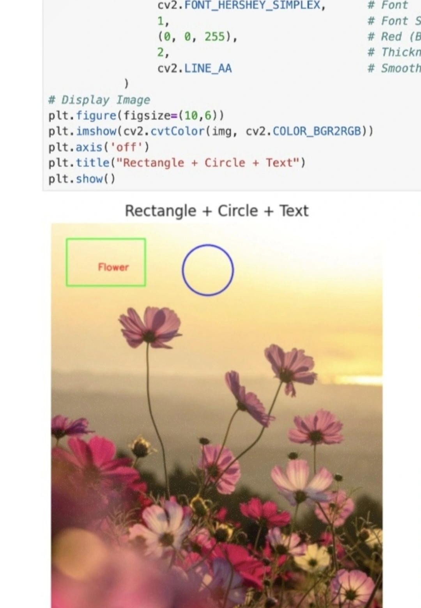
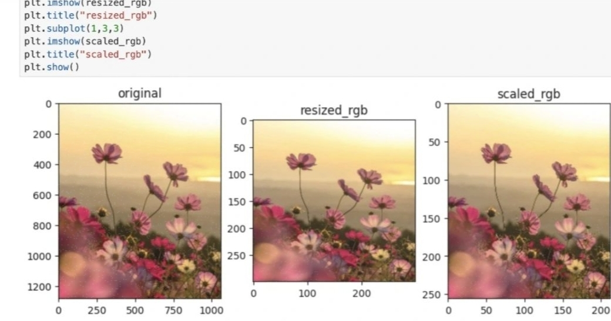
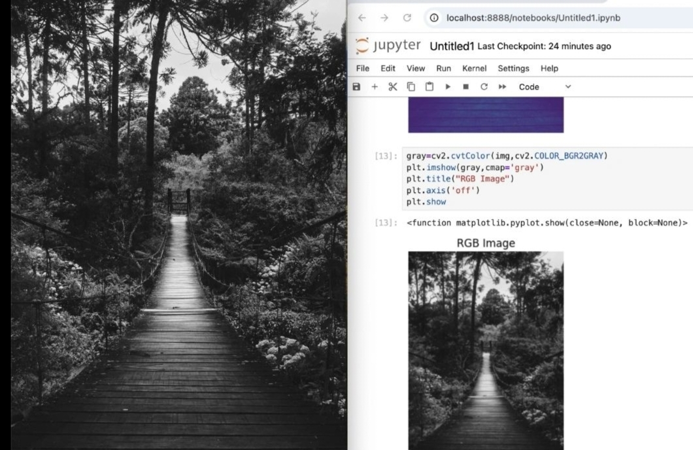
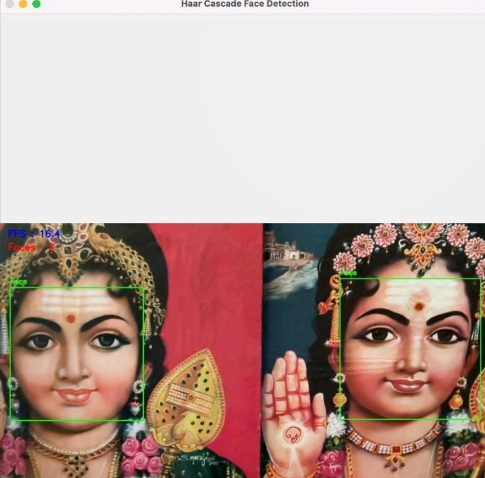

# Computer Vision Projects

A collection of hands-on Computer Vision experiments and projects using Python, OpenCV, and YOLO.

## About This Repository

This repository contains practical implementations of computer vision concepts, including image processing, face detection, and deep-learning-based object detection.

The projects are organized into separate folders for easy navigation.

## Projects

### 1. Image Processing
**Folder:** `01_Image_Processing`

Covers basic image processing operations using OpenCV, including:
- Image loading and displaying
- Resizing and cropping
- Grayscale conversion
- Image flipping and transformations
- Basic drawing operations

### 2. Face Detection
**Folder:** `02_Face_Detection`

Implements real-time face detection using OpenCV Haar Cascade classifiers.

Features:
- Face detection using Haar Cascade
- Webcam-based face detection
- Bounding boxes around detected faces

### 3. YOLO Object Detection
**Folder:** `03_YOLO_Object_Detection`

Explores object detection and other computer vision tasks using the Ultralytics YOLO framework.

Experiments include:
- Image-based object detection
- Real-time webcam object detection
- Image segmentation experiments
- Pose estimation experiments
- Custom model experiments

## Technologies Used

- Python
- OpenCV
- NumPy
- Matplotlib
- Ultralytics YOLO
- Jupyter Notebook

## Repository Structure

```text
Computer-Vision-Projects/
│
├── 01_Image_Processing/
│   ├── images/
│   └── notebooks
│
├── 02_Face_Detection/
│   └── real_time_face_detection.ipynb
│
├── 03_YOLO_Object_Detection/
│   ├── images/
│   └── yolo_object_detection_experiments.ipynb
│
├── .gitignore
└── README.md
```

## Installation

Clone the repository:

```bash
git clone <your-repository-url>
cd Computer-Vision-Projects
```

Install the required libraries:

```bash
pip install opencv-python numpy matplotlib ultralytics jupyter
```

## Running the Notebooks

Open Jupyter Notebook:

```bash
jupyter notebook
```

Navigate to the required project folder and open the notebook.

For notebooks using relative image paths, run Jupyter from the corresponding project folder.

## Notes

- A webcam is required for real-time webcam experiments.
- YOLO pretrained model weights may be downloaded automatically by Ultralytics.
- Custom model weights (`weights.pt`) are not included in this repository. They were provided separately for experimentation.
- Results may vary depending on the model, input images, and hardware.

## Author

**Indu R**

Computer Science and Engineering

## License

This repository is intended for educational and learning purposes.


## 📸 Project Results

### 1. Image Processing

**Drawing Shapes and Text using OpenCV**



**Image Resizing and Scaling**



**Grayscale Image Conversion**



### 2. Face Detection

**Real-Time Face Detection using OpenCV Haar Cascade**



